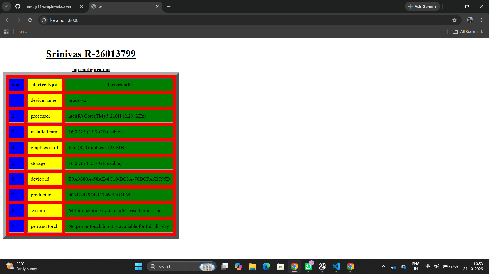
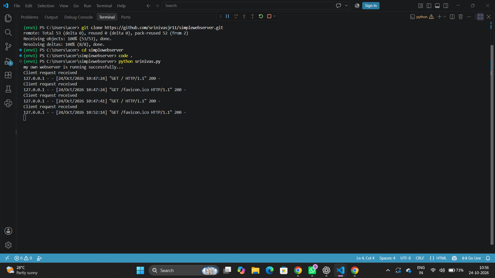

# EX01 Developing a Simple Webserver
## Date:28.09.2026

## AIM:
To develop a simple webserver to serve html pages and display the Windows Specifications of your Laptop.

## DESIGN STEPS:
### Step 1: 
HTML content creation.

### Step 2:
Design of webserver workflow.

### Step 3:
Implementation using Python code.

### Step 4:
Import the necessary modules.

### Step 5:
Define a custom request handler.

### Step 6:
Start an HTTP server on a specific port.

### Step 7:
Run the Python script to serve web pages.

### Step 8:
Serve the HTML pages.

### Step 9:
Start the server script and check for errors.

### Step 10:
Open a browser and navigate to http://127.0.0.1:8000 (or the assigned port).

## PROGRAM:
```
srinivas.py

from http.server import HTTPServer, BaseHTTPRequestHandler
content = """
<html>
   
    <head><title>ex</title></head>

    <body >
   
    
    <table border="10" bgcolor="red" cellspacing="10" cellpadding="10">
      <caption><h1><b><u>Srinivas R-26013799</u> </b></caption>
      <caption><b><u>lap configuration</u></b></h1></caption>
      <tr>
           <th bgcolor="blue">s.no</th>
             <th bgcolor="yellow">device type</th>
                <th bgcolor="green">devices info</th>
      </tr>
           <tr>
                 <td bgcolor="blue">1</td>
                <td bgcolor="yellow">device name</td>
                 <td bgcolor="green">processor</td>
      </tr>

                   <tr>
                 <td bgcolor="blue">2</td>
                <td bgcolor="yellow">processor</td>
                 <td bgcolor="green">ntel(R) Core(TM) 5 210H (2.20 GHz)</td>
      </tr>

                   <tr>
                 <td bgcolor="blue">3</td>
                <td bgcolor="yellow">installed ram</td>
                 <td bgcolor="green">16.0 GB (15.7 GB usable)</td>
      </tr>
                          <tr>
                 <td bgcolor="blue">4</td>
                <td bgcolor="yellow">graphics card</td>
                 <td bgcolor="green">Intel(R) Graphics (128 MB)</td>
      </tr>
                              <tr>
                 <td bgcolor="blue">5</td>
                <td bgcolor="yellow">storage</td>
                 <td bgcolor="green">16.0 GB (15.7 GB usable)</td>
      </tr>

         <tr>
                 <td bgcolor="blue">6</td>
                <td bgcolor="yellow">device id</td>
                 <td bgcolor="green">E9A0880A-58AE-4C10-BC3A-70DCFA6B795D</td>
      </tr>
                    <tr>
                 <td bgcolor="blue">7</td>
                <td bgcolor="yellow">product id</td>
                 <td bgcolor="green">00342-42954-11746-AAOEM</td>
      </tr> 
                          <tr>
                 <td bgcolor="blue">8</td>
                <td bgcolor="yellow">system</td>
                 <td bgcolor="green">64-bit operating system, x64-based processor</td>
      </tr>

                        <tr>
                 <td bgcolor="blue">9</td>
                <td bgcolor="yellow">pen and torch</td>
                 <td bgcolor="green">No pen or touch input is available for this display</td>
      </tr>


    </table>


    </body>
     
</html>
"""
class myhandler(BaseHTTPRequestHandler):
    def do_GET(self):
        print("Client request received")
        self.send_response(200)
        self.send_header('content-type', 'text/html; charset=utf-8')
        self.end_headers()
        self.wfile.write(content.encode())
server_address = ('',8000)
httpd = HTTPServer(server_address,myhandler)
print("my own webserver is running successfully...")
httpd.serve_forever()

```

## OUTPUT:
webpage


serverpage


## RESULT:
The program for implementing simple webserver is executed successfully.
